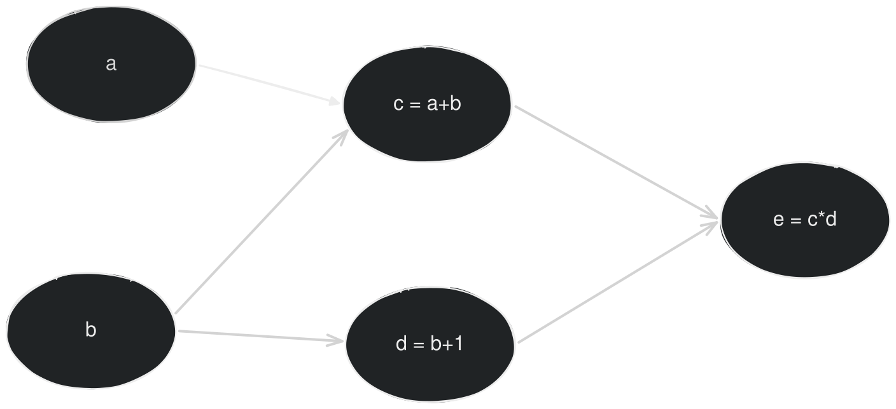
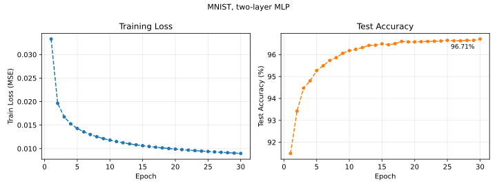

# micrograd

A small automatic differentiation engine.

```c++
#include "micrograd/Tensor.h"
#include <iostream>
using namespace micrograd;

int main() {
  auto a = Tensor::from_values(std::vector<size_t>{1}, std::vector<scalar_t>{2});
  auto b = Tensor::from_values(std::vector<size_t>{1}, std::vector<scalar_t>{1});
  a->set_requires_grad(true);
  b->set_requires_grad(true);

  auto c = a->add(b);       // 3
  auto d = b->add(1.0f);    // 2
  auto e = c->mul(d);       // 6
  e->backward();

  std::cout << e->at({0}) << "\n";                                  // 6
  std::cout << a->grad_at({0}) << " " << b->grad_at({0}) << "\n";   // 2 5
}
```

## Demo


## Build & Run

```bash
cmake -S . -B build
cmake --build build
./build/main
```

`main` trains a small network on MNIST.


## Tests

```bash
cmake -S . -B build -DBUILD_TESTING=ON
cmake --build build
ctest --test-dir build --output-on-failure
```

## Cross-entropy memory

Computed from the tensor shapes and the op graph in `src/nn/Loss.cpp`, not measured.
For logits of shape `[N, C]` in float32, each buffer is `N * C * 4` bytes, and all of
them stay allocated until the step ends.

| Buffer | Rank-2 logits | Rank-3 logits |
|---|---|---|
| Logits, data and grad | 2 | 2 |
| Reshape copy to `[N, C]`, data and grad | 0 | 2 |
| `log_softmax` output, data and grad | 2 | 2 |
| Total | 4 | 6 |

| Config | N | C | One buffer | All buffers |
|---|---|---|---|---|
| MNIST, batch 64 | 64 | 10 | 2,560 B | 10,240 B |
| GPT on FineWeb, defaults (batch 64, block 1024, GPT-2 vocab) | 65,536 | 50,257 | 13.17 GB | 79.05 GB |

At the GPT-2 vocab this is 1.21 MB per token, so the loss buffers grow linearly with
`batch * block`.
