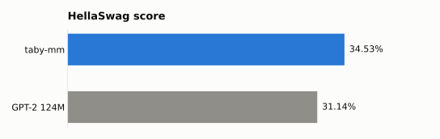
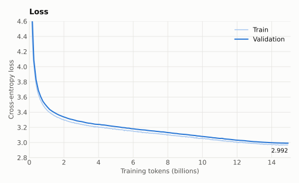
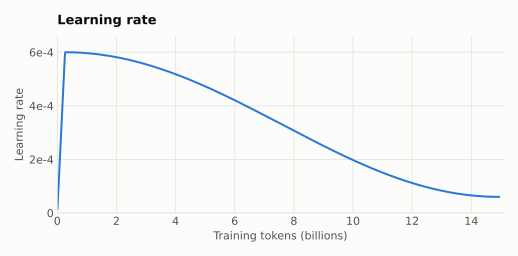

# micrograd

Deep learning framework

| Model | Params | Training tokens | Time to train | Compute | HellaSwag `acc_norm` |
|---|---|---|---|---|---|
| taby-mm | 124M | 14.9B | 3 h 38 min | 8x A100 40 GB | 34.53% |

**Prompt:** The cat and dog went on a walk

**Response:**

> “Oh,” he said, “that was the most wonderful sight I’ve ever seen,” and I saw the cat.
>
> “But you are wrong. You are wrong. I don’t like dogs. That cat is the most wonderful sight I’ve ever seen. I love my cat. I love his company. I love how he has a pet for me. He is the best pet I’ve ever seen. I love how he has a pet for my wife. My wife is the best pet I’ve ever







## Building and Running

### Build

```bash
cmake -S . -B build -DCMAKE_BUILD_TYPE=Debug -DBUILD_TESTING=ON -DFETCH_MNIST=OFF
cmake --build build -j 8
```

On a machine with CUDA:

```bash
cmake -S . -B build-cuda -DCMAKE_BUILD_TYPE=Release -DENABLE_CUDA=ON -DENABLE_CUBLAS=ON -DENABLE_NCCL=ON -DCMAKE_CUDA_ARCHITECTURES=native -DFETCH_MNIST=OFF -DBUILD_TESTING=ON
cmake --build build-cuda -j "$(nproc)" --target micrograd_tests gradcheck dist_check train_gpt
```

### Run

Fetch 150 FineWeb-Edu shards (15B tokens, 29 GB), then train taby-mm on 8 GPUs:

```bash
tools/fetch_fineweb.sh ~/fineweb-data 150
tools/launch.sh 8 build-cuda/train_gpt --data-format fineweb --fineweb-dir ~/fineweb-data --checkpoint runs/long.bin --log runs/long.jsonl --batch-size 16 --grad-accum-steps 1 --block-size 1024 --n-layer 12 --n-head 12 --n-embd 768 --dropout 0 --lr 6e-4 --min-lr 6e-5 --weight-decay 0.1 --beta1 0.9 --beta2 0.99 --grad-clip 1 --warmup-iters 2000 --max-iters 114000 --eval-interval 1000 --eval-iters 100 --checkpoint-interval 1000 --keep-every 10000 --device cuda --seed 1337 --bf16 --pad-vocab --no-recompute
```

| Argument | Value | Description |
|----------|-------|-------------|
| `--batch-size` | 16 | Sequences per GPU per step |
| `--block-size` | 1024 | Context length |
| `--n-layer`, `--n-head`, `--n-embd` | 12, 12, 768 | Model shape |
| `--lr`, `--min-lr` | 6e-4, 6e-5 | Peak and final learning rate, cosine decay |
| `--warmup-iters` | 2000 | Linear warmup steps |
| `--max-iters` | 114000 | Total steps |
| `--checkpoint-interval` | 1000 | Steps between resumable checkpoints |
| `--keep-every` | 10000 | Steps between kept model files |
| `--resume` | path | Continue from a checkpoint |
| `--bf16` | | bf16 activations, fp32 master weights |
| `--pad-vocab` | | Pad the vocabulary to 50,304 rows for speed |
| `--no-recompute` | | Keep activations instead of recomputing them |
